<p align="center">
  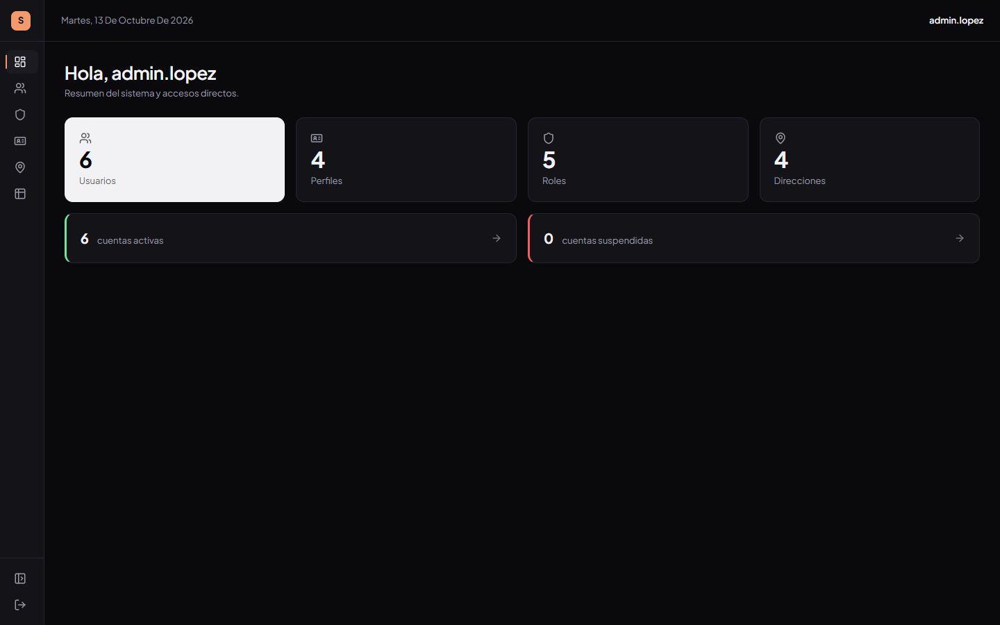
</p>

<h1 align="center">FrontGestionUsuarios</h1>

<p align="center">
  <em>Aplicación web para administrar usuarios, roles, perfiles, direcciones y teléfonos.</em>
</p>

<p align="center">
  
  
  
  
</p>

---

## Índice

- [Qué es](#qué-es)
- [Capturas](#capturas)
- [Stack](#stack)
- [Arquitectura](#arquitectura)
  - [Capas](#capas)
  - [Flujo de datos](#flujo-de-datos)
  - [Modelo de datos](#modelo-de-datos)
- [Estructura del proyecto](#estructura-del-proyecto)
- [API](#api)
- [Sesión](#sesión)
- [Cómo ejecutarlo](#cómo-ejecutarlo)
- [Despliegue](#despliegue)
- [Decisiones de diseño](#decisiones-de-diseño)

---

## Qué es

SPA que administra las entidades de un sistema de usuarios a través de una API REST. Cubre el ciclo completo de cada entidad (listar, crear, editar, eliminar) sobre seis pantallas: acceso, panel, usuarios, roles, perfiles, direcciones y un listado consolidado.

El estado del servidor lo maneja **TanStack Query** (caché, invalidación y reintentos), los formularios **react-hook-form**, y la interfaz está construida con **CSS Modules** sobre un sistema de design tokens propio, sin librerías de componentes.

---

## Capturas

<table>
<tr>
<td width="50%">
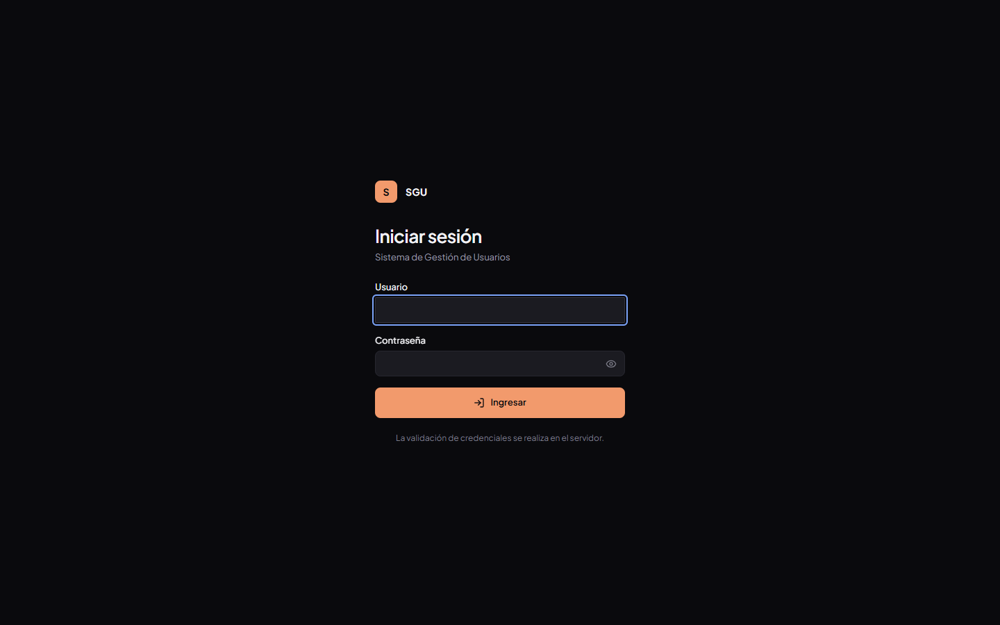<br>
<sub><b>Acceso.</b> Usuario y contraseña, con mostrar/ocultar y validación en servidor.</sub>
</td>
<td width="50%">
<br>
<sub><b>Panel.</b> Métricas reales de usuarios, perfiles, roles y direcciones.</sub>
</td>
</tr>
<tr>
<td>
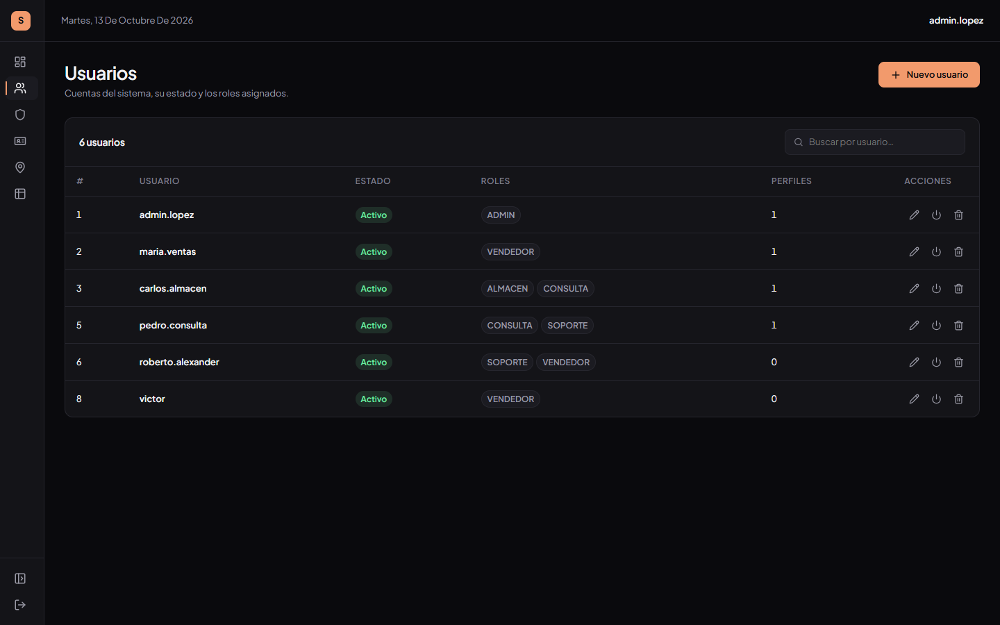<br>
<sub><b>Usuarios.</b> Estado, roles como chips y conteo de perfiles por cuenta.</sub>
</td>
<td>
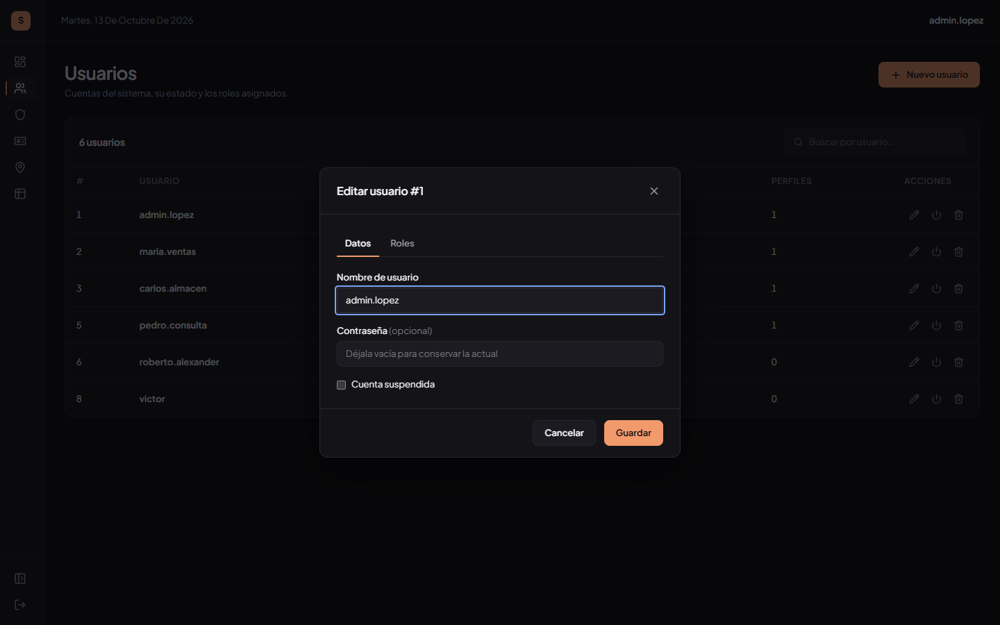<br>
<sub><b>Edición de usuario.</b> Pestañas de datos y asignación de roles.</sub>
</td>
</tr>
<tr>
<td>
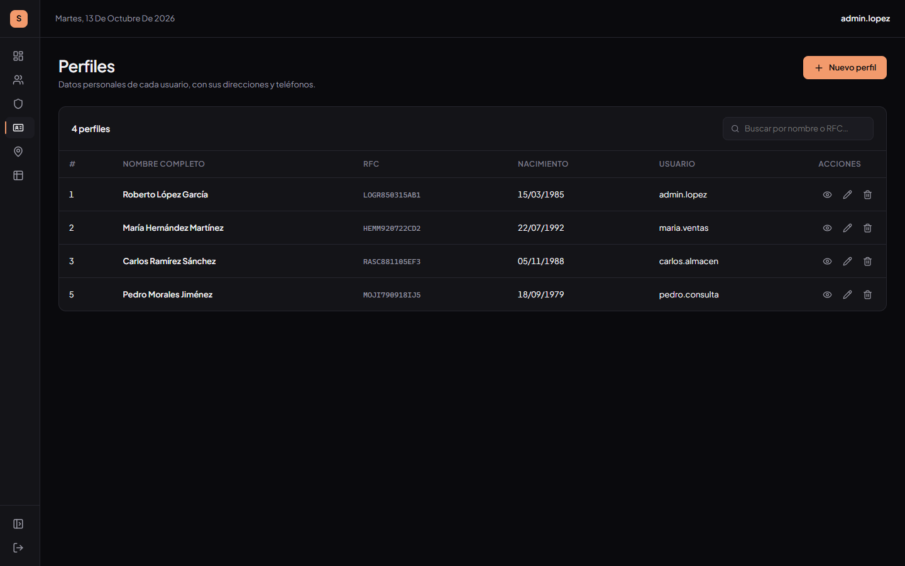<br>
<sub><b>Perfiles.</b> Datos personales, RFC y usuario asociado.</sub>
</td>
<td>
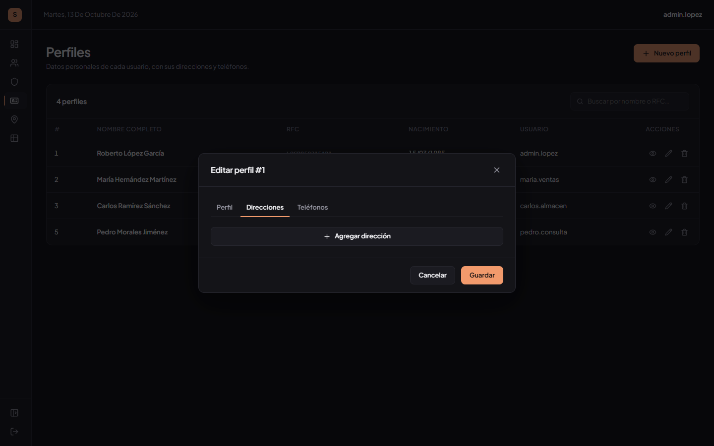<br>
<sub><b>Edición de perfil.</b> Pestañas de perfil, direcciones y teléfonos múltiples.</sub>
</td>
</tr>
<tr>
<td>
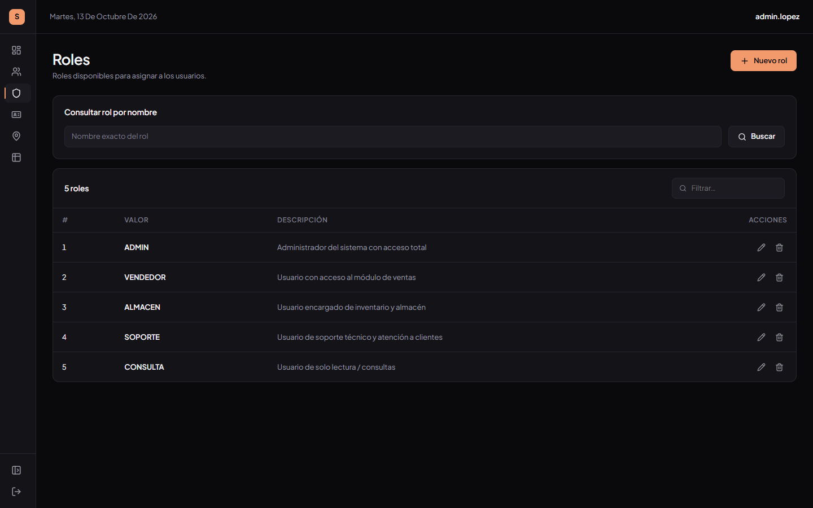<br>
<sub><b>Roles.</b> Búsqueda por nombre contra la API y CRUD.</sub>
</td>
<td>
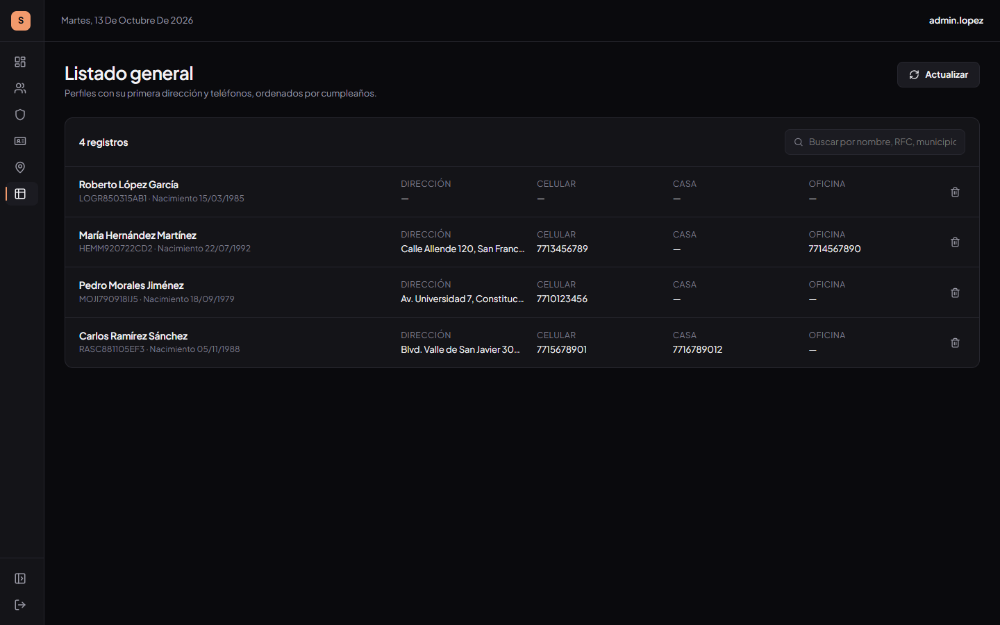<br>
<sub><b>Listado general.</b> Perfiles con dirección y teléfonos, ordenados por cumpleaños.</sub>
</td>
</tr>
</table>

---

## Stack

| Dependencia | Versión | Para qué |
| --- | --- | --- |
| React | 18.3 | Capa de vista |
| TypeScript | 5.6 (estricto) | Tipado de todo el código y de los DTO de la API |
| Vite | 6 | Servidor de desarrollo y empaquetado |
| react-router-dom | 7 | Enrutado del cliente y guards de sesión |
| @tanstack/react-query | 5 | Caché, invalidación y estados de carga/error |
| react-hook-form | 7 | Formularios y validación |
| lucide-react | 0.4 | Iconografía (único set) |
| CSS Modules | nativo de Vite | Estilos encapsulados por componente |

Sin Tailwind, sin librerías de componentes y sin librerías de gráficas. Los estilos se apoyan en variables CSS centralizadas en `src/styles/tokens.css`.

---

## Arquitectura

### Capas

Cada capa conoce solo a la de abajo. La interfaz nunca llama a `fetch` directamente: todo pasa por los recursos tipados, que a su vez usan el cliente HTTP.

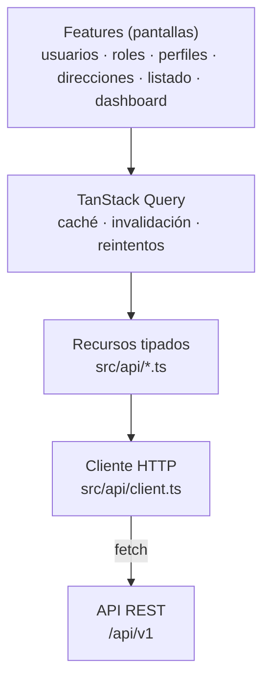

El cliente (`src/api/client.ts`) es el único punto que conoce la URL base y donde se traducen los códigos de estado a mensajes de usuario:

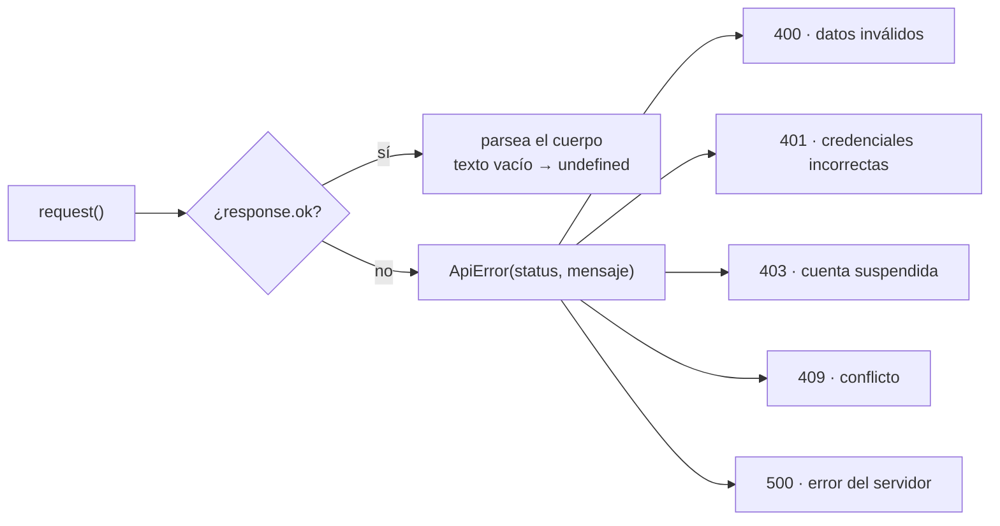

### Flujo de datos

Un componente de pantalla pide datos con `useQuery` y escribe con `useMutation`. Tras cada escritura se invalida la caché de las entidades afectadas, así que las tablas se refrescan solas sin recargar la página.

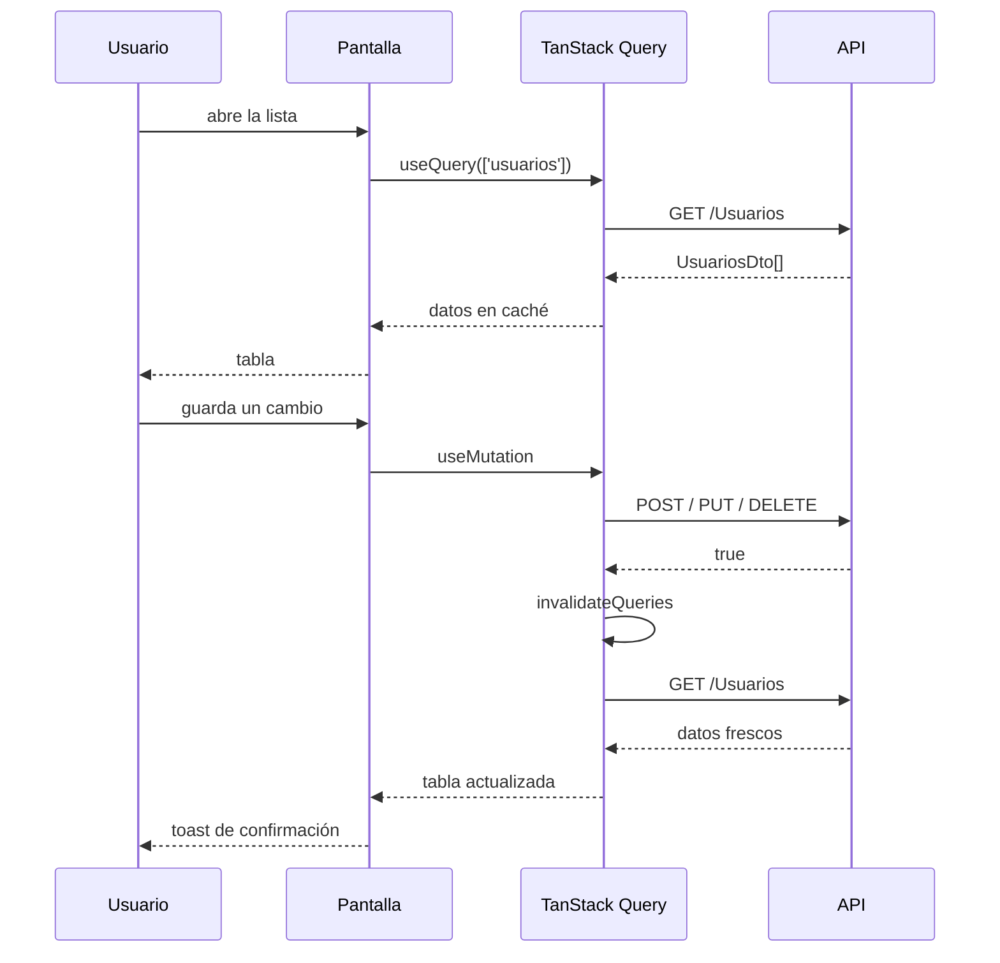

### Modelo de datos

Las entidades y sus relaciones, tal como las expone la API. Los nombres se conservan en **PascalCase**, igual que en el backend, para no traducir el contrato.

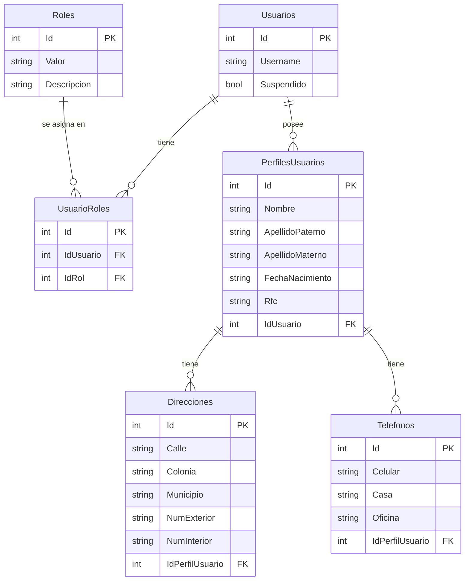

**Un usuario puede tener varios perfiles, y un perfil varias direcciones y varios teléfonos.** La interfaz refleja ese modelo: la tabla de usuarios muestra el conteo de perfiles, y el modal de perfil gestiona listas de direcciones y teléfonos con agregar y quitar por bloque.

---

## Estructura del proyecto

```
src/
├── api/
│   ├── client.ts            Cliente fetch único + clase ApiError
│   ├── types.ts             DTO de la API (PascalCase, como el backend)
│   ├── usuarios.ts          Recurso de usuarios y login
│   ├── roles.ts             Recurso de roles
│   ├── usuarioRoles.ts      Asignación de roles a usuarios
│   ├── perfiles.ts          Recurso de perfiles
│   ├── direcciones.ts       Recurso de direcciones
│   └── telefonos.ts         Recurso de teléfonos
├── components/
│   ├── Button.tsx           Botón con variantes (type="button" por defecto)
│   ├── Modal.tsx            Modal con trampa de foco y cierre con Escape
│   ├── ConfirmDialog.tsx    Confirmación de acciones destructivas
│   ├── DataTable.tsx        Tabla que se apila en tarjetas en móvil
│   ├── Pagination.tsx       Paginación de cliente (10 por página)
│   ├── Toast.tsx            Notificaciones de éxito, aviso y error
│   ├── Badge.tsx            Chips de estado y roles
│   ├── EmptyState.tsx       Estado vacío
│   ├── Skeleton.tsx         Marcador de carga
│   └── layout/AppLayout.tsx Sidebar de iconos y barra superior
├── features/
│   ├── auth/                Login, contexto de sesión y guards
│   ├── dashboard/           Métricas y accesos
│   ├── usuarios/            Tabla y modal con pestañas
│   ├── roles/               Tabla y formulario de roles
│   ├── perfiles/            Tabla, modal y detalle de perfil
│   ├── direcciones/         CRUD de direcciones
│   └── listado/             Listado consolidado
├── styles/
│   ├── tokens.css           Design tokens (colores, espaciado, tipografía)
│   ├── globals.css          Reset y estilos base
│   └── shared.module.css    Estilos compartidos de página y formulario
├── utils/
│   ├── format.ts            Fechas, nombres y vacíos
│   └── validation.ts        Reglas de validación reutilizables
├── App.tsx                  Rutas y guards
└── main.tsx                 Providers (Query, Router, Auth, Toast)
```

---

## API

Base configurable con `VITE_API_URL`. Todas las rutas llevan el prefijo `/api/v1`.

| Recurso | Rutas |
| --- | --- |
| **Usuarios** | `GET /Usuarios`, `GET /Usuarios/{id}`, `GET /Usuarios/username/{username}`, `POST /Usuarios`, `PUT /Usuarios/{id}`, `DELETE /Usuarios/{id}`, `PATCH /Usuarios/{id}/toggle-suspendido` |
| **Login** | `POST /Usuarios/login` |
| **Roles** | `GET /roles`, `GET /roles/{id}`, `GET /roles/nombre/{valor}`, `POST /roles`, `PUT /roles/{id}`, `DELETE /roles/{id}` |
| **UsuarioRoles** | `GET /UsuarioRoles`, `GET /UsuarioRoles/{id}`, `GET /UsuarioRoles/usuario/{idUsuario}`, `POST /UsuarioRoles`, `DELETE /UsuarioRoles/{id}` |
| **PerfilesUsuarios** | `GET /PerfilesUsuarios`, `GET /PerfilesUsuarios/{id}`, `GET /PerfilesUsuarios/usuario/{idUsuario}`, `POST`, `PUT /{id}`, `DELETE /{id}` |
| **Direcciones** | `GET /Direcciones`, `GET /Direcciones/{id}`, `POST /Direcciones`, `PUT /Direcciones/{id}`, `DELETE /Direcciones/{id}` |
| **Telefonos** | `GET /Telefonos`, `GET /Telefonos/{id}`, `GET /Telefonos/numero/{celular}`, `GET /Telefonos/perfil/{idPerfil}`, `POST`, `PUT /{id}`, `DELETE /{id}` |

Comportamiento del backend que la interfaz respeta:

- `POST`, `PUT` y `DELETE` devuelven solo `true`, no el objeto creado. Al crear un perfil, su Id se recupera con `GET /PerfilesUsuarios/usuario/{idUsuario}`, nunca consultando la lista y tomando el último.
- `PUT /Usuarios/{id}` sobrescribe la contraseña. Al editar, el campo va vacío y es opcional: si el usuario no escribe una nueva, no se envía `Password` y el backend conserva la actual.
- Un `DELETE` de rol en uso responde `409` con el mensaje del backend, que se muestra tal cual.
- Los códigos `400`, `404`, `409` y `500` se traducen a mensajes de usuario en el cliente.

---

## Sesión

El backend no emite token ni JWT. El acceso es una llamada a `POST /Usuarios/login` que valida las credenciales en el servidor y devuelve el usuario (sin contraseña). Del resultado solo se guarda en `sessionStorage` el par `{ id, username }`.

- Las rutas internas están protegidas por un guard: sin sesión se redirige a `/login`, y con sesión, `/login` redirige al panel.
- La contraseña **nunca** se persiste ni se renderiza.
- Cuando el backend implemente autenticación real, el único cambio necesario está en `src/features/auth/session.ts`: reemplazar el almacenamiento local por el token que devuelva el login.

---

## Cómo ejecutarlo

**Requisitos:** Node.js 18 o superior y npm 9 o superior.

```bash
npm install
```

Copia `.env.example` a `.env` y ajusta la URL de la API:

```
VITE_API_URL=https://apigestionusuarios.brayandeveloper.online/api/v1
```

`VITE_API_URL` es la única variable. No hay URLs fijas en el código.

| Comando | Qué hace |
| --- | --- |
| `npm run dev` | Servidor de desarrollo |
| `npm run build` | Compila TypeScript y genera el bundle en `dist/` |
| `npm run preview` | Sirve el bundle de producción localmente |
| `npm run typecheck` | Revisa tipos sin generar archivos |

---

## Despliegue

El proyecto incluye `vercel.json` con un rewrite a `/index.html` para que las rutas del cliente funcionen al recargar. La variable `VITE_API_URL` se define en el panel del proveedor, no en el repositorio.

---

## Decisiones de diseño

**CSS Modules y tokens en vez de Tailwind.** El proyecto es pequeño y con pocos componentes. Un archivo de tokens y estilos por componente mantiene el resultado legible y sin build adicional. El tema oscuro vive entero en variables CSS: `--bg`, `--surface`, `--border` y los acentos de estado.

**Un cliente HTTP único.** Toda petición pasa por `src/api/client.ts`, que centraliza la URL base, el manejo de errores y el parseo del cuerpo. Los recursos por entidad solo declaran sus rutas. Cambiar el manejo de errores o añadir cabeceras se hace en un solo sitio.

**TanStack Query para el estado del servidor.** No hay estado global propio: la caché de Query es la fuente de verdad de los datos. Cada mutación invalida las claves que toca (por ejemplo, guardar una dirección invalida `perfiles` y `listado`), así que las vistas se mantienen coherentes sin lógica manual.

**Un componente de paginación.** Las seis listas comparten el mismo `<Pagination>` con diez filas por página y reinicio a la página uno al buscar.

**Accesibilidad desde el inicio.** Foco visible en todos los controles, trampa de foco y cierre con Escape en los modales, `aria-label` en los botones de icono, `role="alert"` en los avisos de error y etiquetas asociadas a cada campo. Las tablas pasan a tarjetas apiladas en móvil para no depender del scroll horizontal.
